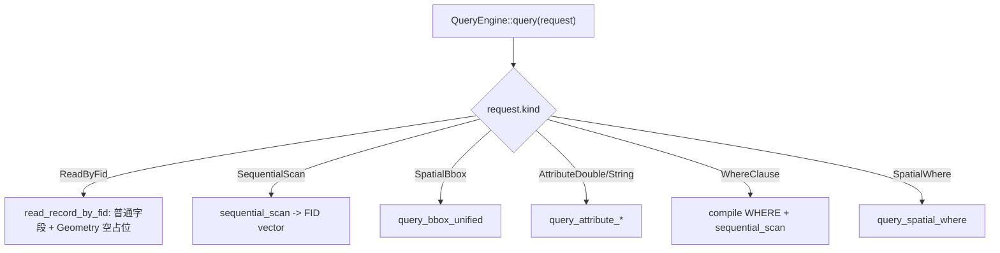
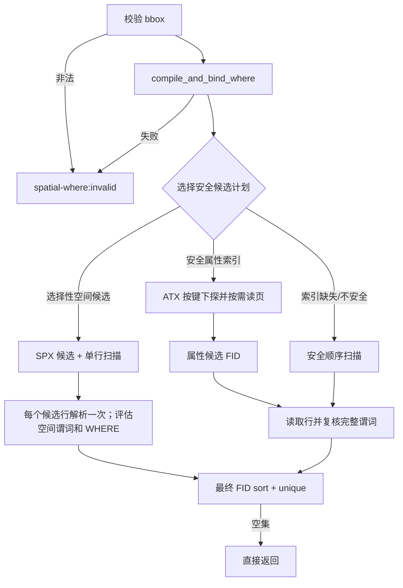
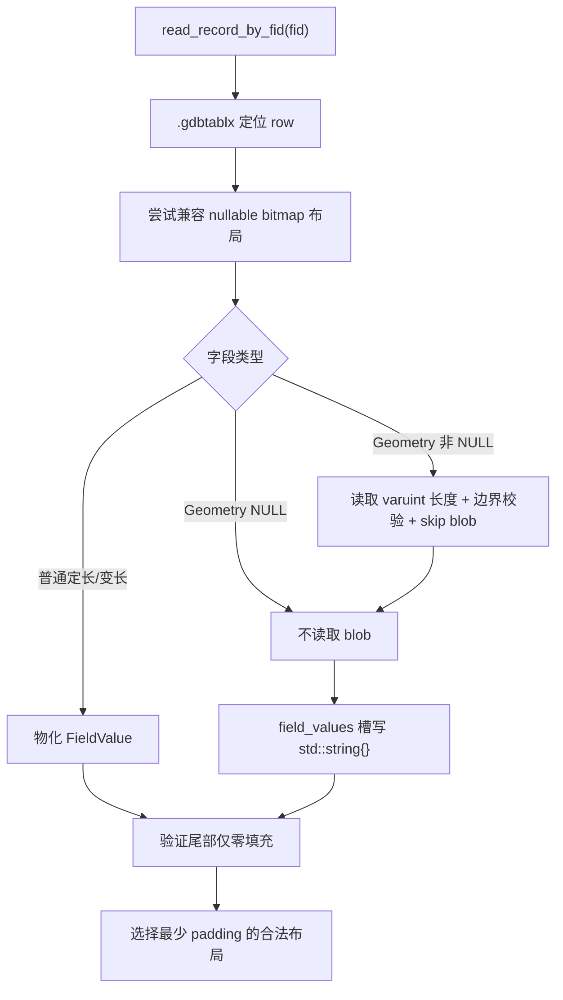
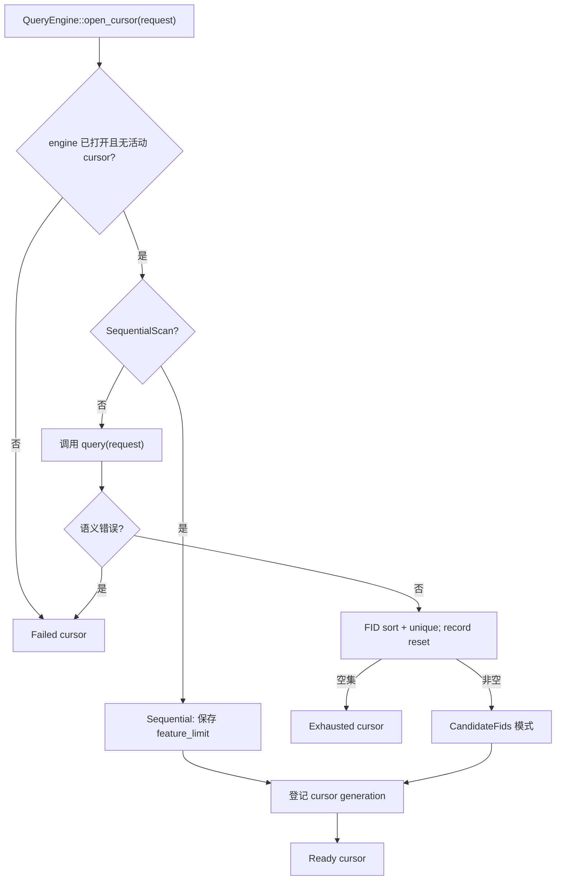
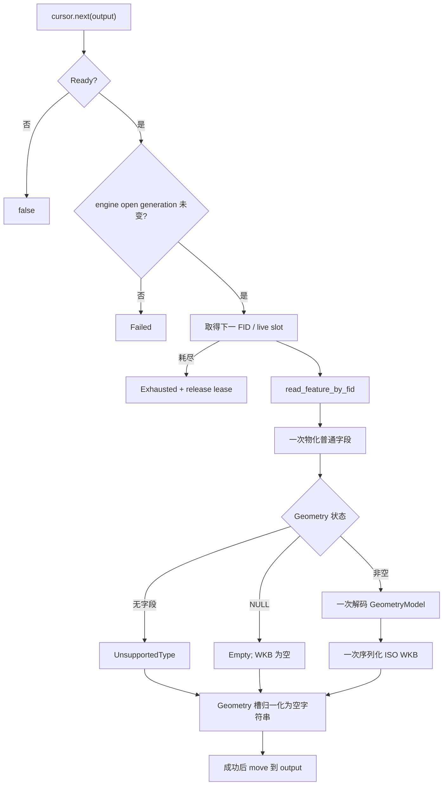
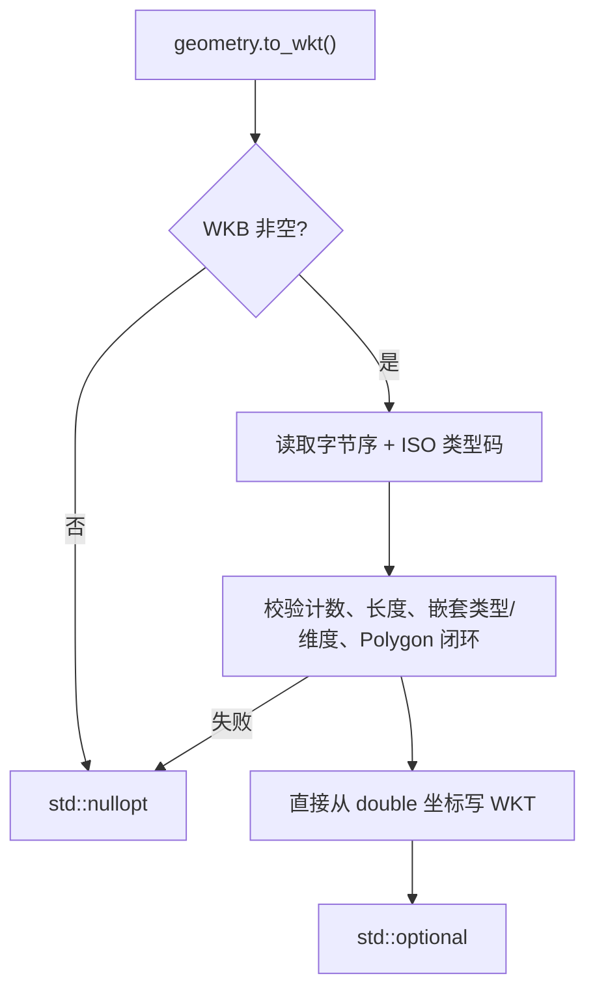

# Reader 查询、WKB-first 完整 Feature 与按需 WKT 流程

当前分支提供：

- `QueryEngine::query()`：FID-only 查询；
- `QueryEngine::open_cursor()`：WKB-first 完整 Feature 流式迭代；
- `FeatureCursor::move_to(fid)`：按零基 FID 前后和跳跃定位；
- `GeometryValue::to_wkt()`：从已读取 ISO WKB 显式转换 WKT。
- `QueryRequest::field_projection` / `include_geometry`：控制返回字段物化和输出几何解码。

> 状态：Current
> 适用版本：v0.2.0+
> 维护入口：docs/gdb/

代码实现已完成；本地默认、GDAL OFF、Adaptive ON、安装包 consumer 验证通过。
跨平台、真实 AWS S3 和外部 Actions runner 仍按 `docs/quality/` 记录为待验证项。

## 1. FID-only 查询分派



`query()` 保持既有 FID 集语义。`ReadByFid` 返回的 record 不包含几何文本或 WKB；
Geometry 槽是字段顺序占位。

## 2. SpatialWhere



不变量：

```text
最终结果 = 精确空间 predicate 命中 ∩ 完整 WHERE 命中
```

`.spx/.atx` 只缩小候选，不能替代最终语义判断。绑定源表的属性查询首次逐键验证原值、FID 唯一性和非 NULL 完整性，再缓存叶页值范围；同代快照后续查询按范围选页，数值有序页内使用二分。目录载荷合计最多 8 项/16 MiB。独立原始 ATX 查询仍使用按键下探及每次查询 16 页缓存；索引缺失或验证失败时仅在安全顺序扫描可建立完整结果的计划下回退。
任何路径都必须复核完整 predicate，不能将不完整索引候选当作最终结果。

## 2.1 字段投影与输出几何开关

未设置 `field_projection` 时返回全部字段；设置后只物化选定字段，未投影字段保留为未物化槽位。
`include_geometry` 默认是 `true`。设为 `false` 后，返回值把几何标为
`GeometryStatus::NotRequested`，行内 blob 仍做长度/边界校验但不构造 GeometryModel 或写 WKB。
空间筛选所需的几何会在查询计划中解码，因此它只省去结果物化阶段的几何输出成本。

```cpp
fast_gdb::unified::Query query;
query.projected_fields = {"name"};
query.attribute_filter = "road_id = 1";
query.include_geometry = false;
auto cursor = layer.open_cursor(query);
```

GDAL 路径只有在无过滤器且驱动报告 `OLCIgnoreFields` 时才请求驱动忽略投影外字段/几何；
有过滤器时保留潜在过滤输入，并在结果映射时应用投影。详见
[S4.4 验证记录](../plan/evidence/2026-11-06-S4.4-projection-lazy-geometry.md)。

## 3. record-only 路径



该路径不创建 `GdbGeomDecoder`，不生成 `GeometryModel`、WKT 或 WKB。Geometry 空字符串
只保持字段数量和描述符顺序；调用方需要几何时另行调用 `read_geometry_value()`。

## 4. open_cursor 规划



候选模式只保存最终 FID vector；SequentialScan 不预先物化全表 FID。

## 5. next() WKB-first 完整对象



输出只在完整读取成功后覆盖；失败不会留下半更新对象。默认路径没有 WKT writer。

## 6. 按需 WKT



转换不重新读取 `.gdbtable`，不调用 GDAL，也不缓存结果。NULL 几何因没有 WKB 返回
`std::nullopt`；合法 WKB Empty 返回 `... EMPTY`。

## 7. move_to(fid)

下一次 `next()` 返回当前查询结果中第一个 `FID >= target` 的对象。

- 支持向前、向后和任意跳跃；
- `move_to(0)` rewind；
- 删除 FID 或不满足过滤的 FID 跳到下一个结果；
- target 后无结果是正常 EOF；
- Exhausted cursor 可 reacquire；
- engine 重开后旧 cursor Failed；
- 其他 cursor 活动时先拒绝 lease，不访问 parser/tablx。

## 8. 状态与生命周期

| 状态 | `next()` | `move_to()` | `done()` | `error()` |
|---|---|---|---:|---|
| Ready | 读取下一条 | 可重新定位 | false | 空 |
| Exhausted | false | 可尝试 reacquire | true | 空 |
| Failed | false | false | false | 首次错误 |
| MovedFrom | false | false | true | 空 |

规则：

- FeatureCursor move-only；
- QueryEngine 不可复制、可移动构造但不可移动赋值；
- QueryEngine、Catalog、ResolvedTable 必须比 cursor 活得更久；
- 同一 engine 同时一个活动 cursor；
- cursor generation 防迟到析构；
- open generation 防 engine reopen 后旧计划复用；
- 活动 cursor 期间 engine 的 open/query/read/scan/直接空间读入口拒绝；
- 不声明同一 QueryEngine 线程安全。

## 8.1 外部修改后的读取

外部 Writer 完成并关闭后，低层 Reader/QueryEngine/Cursor 必须全部销毁，再从新的
`GdbCatalog::scan()` 建立对象图。Unified API 可调用 `Dataset::refresh()`：成功时返回完整
新代次并使旧 Dataset/Layer 过期，失败时不发布部分新状态。调用方需要显式 refresh 或重开，
这不是自动实时刷新。对没有使用协调接口的外部并发 Writer，文件快照检测仍是 best-effort；
发现源变化后丢弃结果，不应在 Writer 活动期间读取。

## 9. WHERE 与索引安全

WHERE 支持比较、AND、OR、IN 和括号。字段名大小写不敏感，字符串支持 `''` 转义。

当前 `.atx` 快速路径边界：

- 绑定字段的字符串、数值、GUID 和受支持日期使用验证目录，最终复核原值；物理键的截断、填充和排序不能替代原值语义。
- WHERE 的具体索引计划由谓词形式与类型决定；函数索引、不明确物理类型或超预算时回退。
- Int64 可调用 `query_attribute_int64()` 保持精度；原始日期 double 是 OLE 日数，typed 日期谓词使用毫秒，两类目录隔离。
- 源行物理布局无法完整读取时返回 Unsupported 并清空部分结果；合法 NULL 和空几何保留既有语义。
- 外部写入关闭后调用 Dataset.refresh，或重建 Catalog、解析图层并打开引擎；相同元数据不能保证检测所有原地改写。

验证范围、性能代价与剩余门禁见 [属性完整性记录](../plan/evidence/2026-11-08-attribute-integrity.md)。

## 10. 主要源码

| 组件 | 文件 |
|---|---|
| 公开接口和状态 | `query_engine.h`、`geometry_model.h` |
| 查询分派和 guard | `query_engine.cpp` |
| FeatureCursor PImpl | `feature_cursor.cpp` |
| 联合查询 | `query_engine_combined.cpp` |
| 空间 planner | `query_engine_geometry.cpp` |
| WHERE | `query_where_internal.h/.cpp` |
| 属性索引 | `gdb_indexes.*`、`gdb_attribute_index.*` |
| record WKB-first 读取 | `gdb_table_record.cpp` |
| one-pass 读取和契约包装 | `gdb_table_feature.cpp`、`gdb_table_feature_contract.cpp` |
| 几何 WKB 输出 | `wkb_writer.cpp` |
| 按需 WKT | `wkb_reader.cpp` |

## 11. 测试入口

| 能力 | 测试 |
|---|---|
| WKB→WKT 纯 C++ | `GeometryValueToWkt.*` |
| record/one-pass 占位 | `FeatureCursorOnePassTest.*` |
| cursor 公开合同 | `FeatureCursorApiTest.*` |
| 顺序、候选、move、GDAL 对等 | `FeatureCursorGdalTest.*` |
| NULL geometry | `FeatureCursorEmptyGeometryTest.*` |
| reopen/reacquire | `FeatureCursorReopenTest.*` |
| WKB-first 100K 基准 | `FeatureCursorBenchmarkTest.*` |
| 联合查询 | `SpatialWhere*Test.*` |
| package consumer | `tests/package_consumer/main.cpp` |

代码审核指南：`docs/quality/10_空间属性联合查询代码审核指南.md`。
